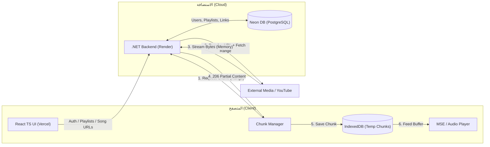
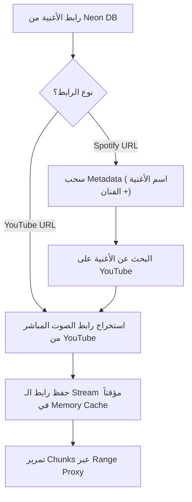
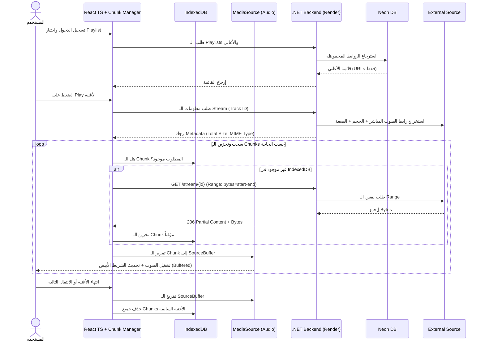

# مخطط التدفق والمعمارية (Architecture & Flow)

هذا الملف يوضح آلية عمل مشروع مشغل الصوتيات الشخصي، وكيفية تدفق البيانات بين الواجهة (**Vercel**)، والـ Backend (**Render**)، وقاعدة البيانات (**Neon DB**)، مع الاعتماد على سحب الصوت على شكل **Chunks** وتخزينها مؤقتاً في المتصفح (`IndexedDB`) دون تخزين أي ملفات صوتية على السيرفر أو الكلاود.

---

## 1. نظرة عامة على المكونات (Components Overview)

### توزيع المسؤوليات:
* **Vercel (`React + TypeScript`):**
  * عرض واجهة المستخدم، تسجيل الدخول، وإدارة الـ Playlists.
  * تشغيل **Chunk Manager** لسحب الأجزاء، حفظها مؤقتاً في `IndexedDB`، وتغذية المشغل (`MSE` / `<audio>`).
  * رسم شريط التقدم (الجزء المشغّل + الجزء المحمّل مسبقاً باللون الأبيض/الرمادي).
  * حذف الـ chunks الخاصة بالأغنية من `IndexedDB` فور انتهائها أو الانتقال لأغنية أخرى.
* **Render (`.NET` Web API):**
  * إدارة المصادقة (Authentication) وعمليات الـ Playlists مع قاعدة البيانات.
  * **URL Resolver:**
    * إذا كان الرابط من **YouTube**: يستخرج رابط الـ stream الصوتي المباشر لحظياً (`WebM/Opus` أو `M4A/AAC`).
    * إذا كان الرابط من **Spotify**: يستخرج اسم الأغنية والفنان (Metadata فقط)، ثم يبحث عن المطابقة على **YouTube** ويجلب رابط الـ stream الصوتي منها (لأن صوتيات Spotify محمية بـ DRM).
    * يخزّن رابط الـ stream المستخرج مؤقتاً في الذاكرة (In-Memory Cache) لفترة قصيرة لتجنب إعادة الاستخراج والبحث مع كل chunk.
  * **Streaming Range Proxy:** استقبال طلبات الـ `Range` من `React` وتمرير الـ bytes من المصدر الخارجي إلى المتصفح مباشرة بالذاكرة دون حفظ أي ملف على القرص.
* **Neon DB (`PostgreSQL`):**
  * تخزين البيانات الوصفية فقط: بيانات الحساب الشخصي، الـ Playlists، وروابط الأغاني الأصلية (`source_url`).

---

## 2. تدفق معالجة الروابط (YouTube & Spotify Resolver Flow)

---

## 3. تدفق تشغيل الأغنية والـ Chunks (Playback & Chunking Flow)

---

## 4. إدارة الكاش المحلي (IndexedDB Lifecycle)

الهدف من `IndexedDB` هو الاحتفاظ بأجزاء الأغنية الحالية فقط أثناء الاستماع:
1. **مفتاح التخزين:** يتم ربط كل chunk بـ `trackId` ورقم/مجال الـ chunk (مثلاً `trackId + chunkIndex`).
2. **التحميل المسبق (Prefetching):** أثناء تشغيل chunk رقم `N`، يقوم الـ Chunk Manager بسحب `N+1` و `N+2` في الخلفية وتخزينها في `IndexedDB` ليظهر الشريط الأبيض متقدماً على التشغيل.
3. **التقديم والتأخير (Seeking):** إذا قفز المستخدم إلى ثانية معينة، يحسب الـ Chunk Manager رقم الـ chunk المقابل؛ إذا كان موجوداً في `IndexedDB` يقرأه فوراً، وإلا يطلبه عبر `Range` من `.NET`.
4. **التنظيف (Cleanup):**
   * عند انتهاء الأغنية (`ended`) أو الضغط على **Next / Previous**: يتم حذف كل السجلات المرتبطة بـ `trackId` القديم من `IndexedDB`.
   * عند فتح التطبيق لأول مرة: يُفضّل عمل فحص سريع لمسح أي chunks عالقة من جلسة سابقة أُغلق فيها المتصفح فجأة.

---

## 5. ملاحظات مهمة خاصة ببيئة الرفع (Vercel + Render + Neon)

1. **إعدادات CORS على Render:**
   * يجب السماح لدومين `Vercel` بالوصول إلى الـ Backend.
   * يجب كشف (Expose) الـ headers التالية في الاستجابة حتى يتمكن `fetch` في `React` من قراءة حجم الملف ونطاق البايتات: `Content-Range`، `Accept-Ranges`، و `Content-Length`.
2. **صيغة الصوت مع MSE:**
   * متصفحات الويب تتعامل بشكل ممتاز مع `MediaSource` عندما يكون الـ stream بصيغة `WebM (Opus)` أو `fMP4 (AAC)`، بينما `MP3` الخام قد لا يكون مدعوماً في `MSE` على بعض المتصفحات (مثل Safari).
3. **تخزين الرابط المستخرج مؤقتاً في `.NET`:**
   * عند تشغيل أغنية واحدة، سيرسل `React` عدة طلبات `Range` متتالية (واحد لكل chunk).
   * وجود Cache مؤقت في ذاكرة `.NET` يربط `trackId` برابط الـ stream المستخرج يمنع إعادة استخراج الرابط من المصدر الخارجي مع كل chunk، مما يسرّع التشغيل ويقلل احتمالية الحظر.
4. **سكون السيرفر على Render (Free Tier):**
   * إذا كنت تستخدم الخطة المجانية على Render، سيتوقف السيرفر بعد فترة من عدم الاستخدام، وقد يستغرق أول طلب تشغيل أو تسجيل دخول ~30–50 ثانية للاستيقاظ.
5. **الـ IP على Render مع الروابط الخارجية:**
   * بما أن Render يعمل على سيرفرات سحابية (Datacenter IPs)، قد تفرض بعض المواقع مثل YouTube قيوداً أو تطلب تحققاً أحياناً، وبما أن الاستخدام شخصي فالأمر يكون أخف، لكن يُفضّل معالجة أخطاء الاستخراج وإظهار رسالة واضحة في الواجهة إذا تعذّر جلب المصدر.
